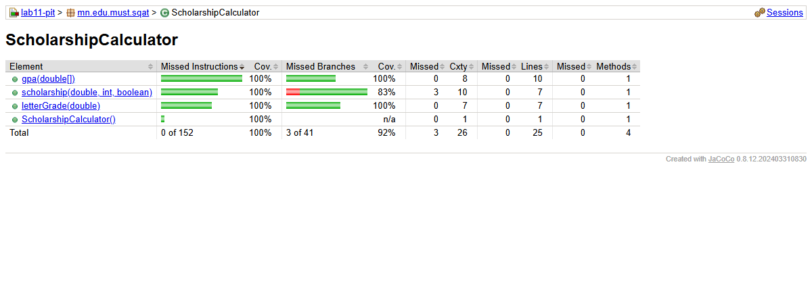

# Лаб 11 — Mutation testing: PIT-ээр тестийн чанараа хэмжих

F.CSA313 — Программ хангамжийн чанарын баталгаа ба тест (2026)

- **Нэр:** Э.Батхүлэг
- **Оюутны код:** B232270040

### `java -version`

```
java version "23.0.2" 2025-01-21
Java(TM) SE Runtime Environment (build 23.0.2+7-58)
Java HotSpot(TM) 64-Bit Server VM (build 23.0.2+7-58, mixed mode, sharing)
```

### `mvn -version`

```
Apache Maven 3.9.16 (2bdd9fddda4b155ebf8000e807eb73fd829a51d5)
Maven home: D:\apache-maven-3.9.16-bin\apache-maven-3.9.16
Java version: 23.0.2, vendor: Oracle Corporation, runtime: D:\java
Default locale: en_US, platform encoding: UTF-8
OS name: "windows 11", version: "10.0", arch: "amd64", family: "windows"
```

Орчин: Windows 11 + Git Bash (`tee` нь UTF-8 бичдэг тул `results/` дахь бүх файл текст).
`pom.xml`-д `maven.compiler.release=17` тул JDK 23 дээр Java 17 bytecode үүснэ.
`src/main` кодыг лабын турш өөрчлөөгүй — зөвхөн `src/test` засагдсан (`git diff <Starter> -- src/main` хоосон).

Бүх мөрийн дугаар нь `src/main/java/mn/edu/must/sqat/ScholarshipCalculator.java` файлын мөр:

| Мөр | Код |
|---|---|
| 20 | `if (score < 0 \|\| score > 100) throw ...` |
| 23–27 | `if (score >= 90) return "A";` … `if (score >= 60) return "D"; return "F";` |
| 31 | `if (scores == null \|\| scores.length == 0) throw ...` |
| 36–40 | `switch (letterGrade(s))` — `case "A": total += 4` … `case "D": total += 1` |
| 44 | `return total / scores.length;` |
| 48 | `if (gpa < 0 \|\| gpa > 4 \|\| credits < 0) throw ...` |
| 51 | `if (hasViolation) return 0;` |
| 52 | `if (gpa >= 3.8 && credits >= 15) return 100;` |
| 53 | `if (gpa >= 3.4 && credits >= 12) return 70;` |
| 54 | `if (gpa >= 3.0) return 50;` |

---

## Эхний хэмжилт (Starter)

```bash
mkdir -p results
mvn clean verify 2>&1 | tee results/mvn-verify-start.txt
cp target/site/jacoco/jacoco.csv results/jacoco-start.csv
mvn test-compile org.pitest:pitest-maven:mutationCoverage 2>&1 | tee results/pit-start.txt
```

**JaCoCo** ([results/jacoco-start.csv](results/jacoco-start.csv)): `BRANCH_MISSED=3, BRANCH_COVERED=38, LINE_MISSED=0, LINE_COVERED=25`
→ **Line 100% (25/25), Branch 38/41 (92%)**.



**PIT** ([results/pit-start.txt](results/pit-start.txt)):

```
>> Line Coverage (for mutated classes only): 25/25 (100%)
>> Generated 63 mutations Killed 17 (27%)
>> Mutations with no coverage 0. Test strength 27%
```


**Ажиглалт.** Line Coverage 100% боловч Mutation Coverage ердөө 27% (63-аас 17) — 46 мутант
кодыг өөрчилсөн ч ямар ч тест унасангүй. Энэ нь тестүүд мөр бүрийг *ажиллуулж* байгаа ч
үр дүнг нь бараг *шалгахгүй* байгааг (`assertNotNull`, `assertTrue(0 <= x <= 100)`) харуулж байна.
Өөрөөр хэлбэл хамралт "код ажилласан уу" гэдгийг, mutation score "буруу ажилласныг тест барих уу" гэдгийг хэмждэг.

---
