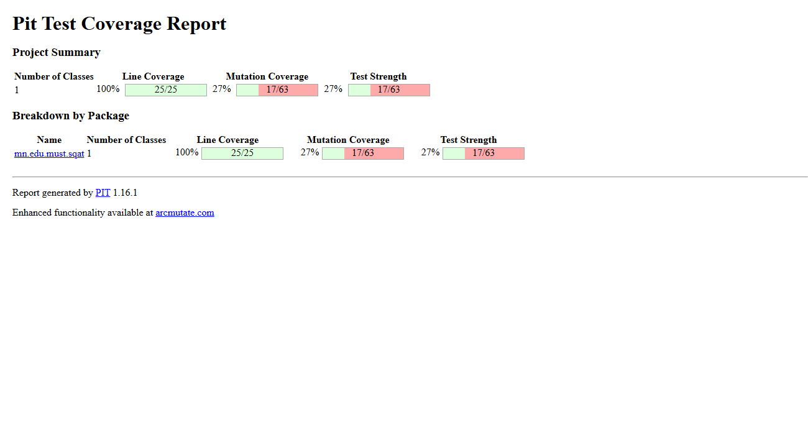
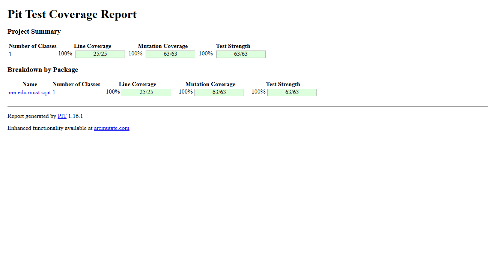

# Лаб 11 — Mutation testing: PIT-ээр тестийн чанараа хэмжих

F.CSA313 — Программ хангамжийн чанарын баталгаа ба тест (2026)

- **Нэр:** Э.Батхүлэг
- **Оюутны код:** B232270040

### `java -version`

```
java version "23.0.2" 2025-01-21
Java(TM) SE Runtime Environment (build 23.0.2+7-58)
Java HotSpot(TM) 64-Bit Server VM (build 23.0.2+7-58, mixed mode, sharing)
```

### `mvn -version`

```
Apache Maven 3.9.16 (2bdd9fddda4b155ebf8000e807eb73fd829a51d5)
Maven home: D:\apache-maven-3.9.16-bin\apache-maven-3.9.16
Java version: 23.0.2, vendor: Oracle Corporation, runtime: D:\java
Default locale: en_US, platform encoding: UTF-8
OS name: "windows 11", version: "10.0", arch: "amd64", family: "windows"
```

Орчин: Windows 11 + Git Bash (`tee` нь UTF-8 бичдэг тул `results/` дахь бүх файл текст).
`pom.xml`-д `maven.compiler.release=17` тул JDK 23 дээр Java 17 bytecode үүснэ.
`src/main` кодыг лабын турш өөрчлөөгүй — зөвхөн `src/test` засагдсан (`git diff <Starter> -- src/main` хоосон).

Бүх мөрийн дугаар нь `src/main/java/mn/edu/must/sqat/ScholarshipCalculator.java` файлын мөр:

| Мөр | Код |
|---|---|
| 20 | `if (score < 0 \|\| score > 100) throw ...` |
| 23–27 | `if (score >= 90) return "A";` … `if (score >= 60) return "D"; return "F";` |
| 31 | `if (scores == null \|\| scores.length == 0) throw ...` |
| 36–40 | `switch (letterGrade(s))` — `case "A": total += 4` … `case "D": total += 1` |
| 44 | `return total / scores.length;` |
| 48 | `if (gpa < 0 \|\| gpa > 4 \|\| credits < 0) throw ...` |
| 51 | `if (hasViolation) return 0;` |
| 52 | `if (gpa >= 3.8 && credits >= 15) return 100;` |
| 53 | `if (gpa >= 3.4 && credits >= 12) return 70;` |
| 54 | `if (gpa >= 3.0) return 50;` |

---

## Эхний хэмжилт (Starter)

```bash
mkdir -p results
mvn clean verify 2>&1 | tee results/mvn-verify-start.txt
cp target/site/jacoco/jacoco.csv results/jacoco-start.csv
mvn test-compile org.pitest:pitest-maven:mutationCoverage 2>&1 | tee results/pit-start.txt
```

**JaCoCo** ([results/jacoco-start.csv](results/jacoco-start.csv)): `BRANCH_MISSED=3, BRANCH_COVERED=38, LINE_MISSED=0, LINE_COVERED=25`
→ **Line 100% (25/25), Branch 38/41 (92%)**.


**PIT** ([results/pit-start.txt](results/pit-start.txt)):

```
>> Line Coverage (for mutated classes only): 25/25 (100%)
>> Generated 63 mutations Killed 17 (27%)
>> Mutations with no coverage 0. Test strength 27%
```



**Ажиглалт.** Line Coverage 100% боловч Mutation Coverage ердөө 27% (63-аас 17) — 46 мутант
кодыг өөрчилсөн ч ямар ч тест унасангүй. Энэ нь тестүүд мөр бүрийг *ажиллуулж* байгаа ч
үр дүнг нь бараг *шалгахгүй* байгааг (`assertNotNull`, `assertTrue(0 <= x <= 100)`) харуулж байна.
Өөрөөр хэлбэл хамралт "код ажилласан уу" гэдгийг, mutation score "буруу ажилласныг тест барих уу" гэдгийг хэмждэг.

---

## Хэсэг A — Амьд мутантуудын ангилал (starter дээр 46 SURVIVED)

PIT-ийн `mutations.xml`-ээс SURVIVED мутант бүрийг гаргаж, мөр + мутацийн төрлөөр нэгтгэв.
"Алсан алхам" багана нь тухайн мутантыг аль засвар алсныг заана (B1 = яг утгын assertion, B2 = зааг/хослолын тест).

| # | Мөр | Мутаци (PIT-ийн тайлбар) | Тоо | Ангилал | Арга хэмжээ | Алсан алхам |
|---|---|---|---|---|---|---|
| 1 | 20 | changed conditional boundary (`score < 0` → `<= 0`, `score > 100` → `>= 100`) | 2 | Тест дутуу | `letterGrade(0)="F"`, `letterGrade(100)="A"` зааг тест | B2 |
| 2 | 23, 24, 25, 26 | changed conditional boundary (`>= 90/80/70/60` → `>`) | 4 | Тест дутуу | 90/89.99, 80/79.99, 70/69.99, 60/59.99 зааг тест | B2 |
| 3 | 23, 24, 25, 26 | removed conditional – replaced comparison check with **false** | 4 | Тест дутуу | Яг үсгийг `assertEquals`-ээр шалгах | B1 |
| 4 | 23, 24, 25, 26 | removed conditional – replaced comparison check with **true** | 4 | Тест дутуу | Яг үсгийг `assertEquals`-ээр шалгах | B1 |
| 5 | 23, 24, 25, 26, 27 | replaced return value with `""` | 5 | Тест дутуу | `assertNotNull` → `assertEquals("A"…"F", …)` | B1 |
| 6 | 36 | Changed switch default to be first case | 1 | Тест дутуу | gpa-гийн яг утга шалгах (A нь 4 биш 0 болно) | B1 |
| 7 | 38, 40 | Replaced double addition with subtraction (`total += 3` / `+= 1` → `-=`) | 2 | Тест дутуу | `gpa({95,85}) = 3.5`, `gpa({75,65}) = 1.5` яг утга | B1 |
| 8 | 44 | replaced double return with 0.0d | 1 | Тест дутуу | Голчийг `assertEquals(…, EPS)`-ээр шалгах | B1 |
| 9 | 48 | changed conditional boundary (`gpa < 0` → `<= 0`, `credits < 0` → `<= 0`) | 2 | Тест дутуу | `scholarship(0.0, 0, false) = 0`, `scholarship(3.0, 0, false) = 50` | B2 |
| 10 | 48 | removed conditional – replaced comparison check with true (`gpa < 0` шалгалт алга) | 1 | Тест дутуу | `scholarship(-0.01, …)` → exception | B2 |
| 11 | 51 | removed conditional – replaced equality check with true / false (`hasViolation`) | 2 | Тест дутуу | Зөрчилтэй → яг 0, зөрчилгүй → яг 100/70/50 | B1 |
| 12 | 52, 53, 54 | changed conditional boundary (`>= 3.8`, `>= 15`, `>= 3.4`, `>= 12`, `>= 3.0` → `>`) | 5 | Тест дутуу | 3.8/15, 3.4/12, 3.0 яг зааг дээрх тест | B2 |
| 13 | 52, 53, 54 | removed conditional – replaced comparison check with false | 5 | Тест дутуу | Дүрэм бүрийн яг хувь (100/70/50) | B1 |
| 14 | 54 | removed conditional – replaced comparison check with true | 1 | Тест дутуу | `scholarship(3.1, 5) = 50`, `(2.0, 1) = 0` яг утга | B1 |
| 15 | 52, 53 | removed conditional – replaced comparison check with true (`&&`-ийн нэг хэсэг алга) | 4 | Тест дутуу | Нэг нөхцөл л биелэх хослол: (3.5,16)→70, (3.9,14)→70, (3.1,13)→50, (3.5,11)→50 | B2 |
| 16 | 52, 53, 54 | replaced int return with 0 | 3 | Тест дутуу | `assertTrue(0..100)` → `assertEquals(100/70/50, …)` | B1 |
| | | **Нийт** | **46** | **46 тест дутуу, 0 equivalent** | | B1: 28, B2: 18 |

**Ангилал бүрийн үндэслэл (нэг өгүүлбэрээр):**

1. `score < 0` → `<= 0` нь 0 оноонд exception шиддэг болгож, `> 100` → `>= 100` нь 100 оноонд exception шиддэг болгодог тул бодит зан төлөв өөрчлөгдөнө — тест дутуу.
2. `>= 90` → `> 90` нь яг 90 оноог "B" болгодог тул зан төлөв өөрчлөгдөнө — тест дутуу (starter-т 90, 80, 70, 60 утга байгаагүй).
3–4. Нөхцөлийг үргэлж true/false болговол тухайн үсэг огт гарахгүй эсвэл бүх оноо тэр үсэг болно — үр дүн өөр тул тест дутуу (`assertNotNull` үүнийг барьдаггүй).
5. `""` буцаах нь `null` биш тул `assertNotNull` давдаг ч спецификацид буруу — тест дутуу.
6. Switch-ийн "A" салааг default руу шилжүүлбэл A-ийн оноо 4 биш 0 болно — голч өөрчлөгдөнө, тест дутуу.
7. `+= 3` → `-= 3` нь голчийг сөрөг/өөр болгодог; starter зөвхөн "0–4 мужид" гэж шалгадаг тул (жишээ нь (4-3)/2 = 0.5 мужид багтана) барьсангүй — тест дутуу.
8. 0.0 нь 0–4 мужид багтах тул сул assertion давдаг ч бодит утга буруу — тест дутуу.
9. `gpa <= 0` / `credits <= 0` нь хүчинтэй 0 утгыг exception болгодог тул зан төлөв өөр — тест дутуу (0 утгаар тест байгаагүй).
10. `gpa < 0` шалгалт арилбал сөрөг голч exception-гүй 0 буцаана — тест дутуу (сөрөг gpa-гийн тест байгаагүй).
11. `hasViolation`-ийг үргэлж true болговол бүх хүн 0 авна, false болговол зөрчилтэй ч тэтгэлэг авна — тест дутуу.
12. `>= 3.8` → `> 3.8` нь яг 3.8/15 оюутныг 100%-аас 70% руу буулгана (Хэсэг C-д гараар баталсан) — тест дутуу.
13. Дүрмийн нөхцөлийг false болговол 100/70/50 нь доод шатны утга болно; 0–100 мужид багтах тул сул тест барьсангүй — тест дутуу.
14. `gpa >= 3.0`-ийг true болговол 3.0-аас доош голчтой оюутан 50% авна — тест дутуу.
15. `gpa >= 3.8 && credits >= 15`-ийн аль нэг хэсгийг арилгавал зөвхөн нэг нөхцөл хангасан оюутан ч 100% авна; starter-ийн оролтууд хоёулаа зэрэг хангагдсан/хангагдаагүй байсан тул ялгаагүй — тест дутуу.
16. 0 нь 0–100 мужид багтах тул сул assertion давдаг ч 100/70/50 байх ёстой — тест дутуу.

**Equivalent мутант олдсонгүй.** Бүх 46 амьд мутант кодын ажиглагдах үр дүнг (буцаах утга эсвэл exception) өөрчилдөг
бөгөөд B1+B2-ийн дараа 63/63 бүгд алагдсан нь энэ ангиллыг баталж байна.

---

## Хэсэг B — Тестүүдээ хүчтэй болгох

### B1 — Яг утгын assertion

Оролтын утгуудыг starter-тэй **ижил** үлдээж, зөвхөн assertion-уудыг сольсон:

| Starter | B1 |
|---|---|
| `assertNotNull(calc.letterGrade(95))` | `assertEquals("A", calc.letterGrade(95))` (B, C, D, F мөн адил) |
| `assertTrue(g1 >= 0 && g1 <= 4)` | `assertEquals(3.5, calc.gpa(new double[]{95, 85}), EPS)` гэх мэт |
| `assertTrue(s1 >= 0 && s1 <= 100)` | `assertEquals(100, calc.scholarship(3.9, 16, false))` гэх мэт |

### B2 — Зааг утга ба хослолын тестүүд

- `letterGrade_boundaries` (parameterized, 10 тохиолдол): 100, 90/89.99, 80/79.99, 70/69.99, 60/59.99, 0.
- `letterGrade_justOutsideRange_throws`: -0.01, 100.01.
- `gpa_singleLetter_exactPoints` (5): switch-ийн A/B/C/D/F үсэг тус бүр; `gpa_mixedAllLetters_exactAverage`; `gpa_invalidScoreInside_throws`.
- `scholarship_boundariesAndCombinations` (15): 3.8/15, 3.79/15, 3.8/14, 3.4/12, 3.39/12, 3.4/11, 3.0/0, 2.99/20,
  gpa 0 ба 4, credits 0, мөн `&&`-ийн зөвхөн нэг хэсэг биелэх хослолууд (3.5/16, 3.9/14, 3.1/13, 3.5/11).
- `scholarship_violationAlwaysZero`: зааг дээрх оюутан ч зөрчилтэй бол 0.
- `scholarship_outOfRangeInputs_throw`: gpa -0.01 ба 4.01, credits -1, сөрөг gpa + зөрчил.

### Гурван хэмжилтийн явц

```bash
mvn test-compile org.pitest:pitest-maven:mutationCoverage 2>&1 | tee results/pit-B1.txt   # B1-ийн дараа
mvn test-compile org.pitest:pitest-maven:mutationCoverage 2>&1 | tee results/pit-B2.txt   # B2-ийн дараа
```

| Хэмжилт | Файл | `>> Generated … Killed …` мөр | Test strength | Амьд |
|---|---|---|---|---|
| Эхлэл | [results/pit-start.txt](results/pit-start.txt) | `>> Generated 63 mutations Killed 17 (27%)` | 27% | 46 |
| B1-ийн дараа | [results/pit-B1.txt](results/pit-B1.txt) | `>> Generated 63 mutations Killed 45 (71%)` | 71% | 18 |
| B2-ийн дараа (эцсийн) | [results/pit-B2.txt](results/pit-B2.txt) | `>> Generated 63 mutations Killed 63 (100%)` | 100% | 0 |

- B1 нь +28 мутант алсан: бүх "replaced return value", "removed conditional → false", math, switch мутантууд — сул assertion-ыг илрүүлдэг төрлүүд.
- B1-ийн дараа үлдсэн 18 нь бүгд "changed conditional boundary" (13) ба `&&`/хязгаарын "removed conditional → true" (5) — оролтын утга өөр байхгүй бол яг утгын assertion ч тэдгээрийг барьж чадахгүй. B2 эдгээрийг бүгдийг алсан.
- Эцсийн JaCoCo ([results/jacoco-final.csv](results/jacoco-final.csv)): Line 25/25, **Branch 41/41** (starter-т 38/41 байсан).

**Эцсийн PIT тайлан:**



---

## Хэсэг C — Гараар нэг мутант (PIT-гүйгээр)

### Гар мутант: мөр 52 `gpa >= 3.8` → `gpa > 3.8`

```bash
# мөр 52-ийг гараар өөрчилсөн: if (gpa > 3.8 && credits >= 15) return 100;
mvn test 2>&1 | tee results/mvn-test-manual-mutant.txt
git restore src/main      # анхны кодыг сэргээсэн — мутацитай кодыг commit хийгээгүй
```

Үр дүн ([results/mvn-test-manual-mutant.txt](results/mvn-test-manual-mutant.txt)):

```
[ERROR] Tests run: 41, Failures: 1, Errors: 0, Skipped: 0
[ERROR] mn.edu.must.sqat.ScholarshipCalculatorTest.scholarship_boundariesAndCombinations(double, int, int)[1]
org.opentest4j.AssertionFailedError: expected: <100> but was: <70>
[ERROR]   ScholarshipCalculatorTest.scholarship_boundariesAndCombinations:156 expected: <100> but was: <70>
```

- **Унасан тест:** `scholarship_boundariesAndCombinations` — 1-р тохиолдол `"3.8, 15, 100"` (B2-д нэмсэн яг заагийн тест).
- Мутацитай кодонд яг 3.8 голчтой оюутан эхний дүрмийг давахгүй, 70% авна → `expected: <100> but was: <70>`.
- Бусад 40 тест давсан: 3.9/16 ба 4.0/15 нь заагаас дээш тул `>` ба `>=` ялгаагүй. Starter-ийн багцад энэ мутант амьд үлдэх байсан (3.9 л шалгадаг, тэгээд `assertTrue(мужид)`).

### Өөрийн equivalent мутант: мөр 31 `scores.length == 0` → `scores.length <= 0`

```java
if (scores == null || scores.length <= 0) {   // анх: scores.length == 0
```

Java-д массивын урт хэзээ ч сөрөг байж чадахгүй (`length >= 0` нь JVM-ийн баталгаа), тиймээс `length <= 0` ба
`length == 0` нь бүх боломжит оролт дээр яг ижил true/false өгнө. Ажиглагдах зан төлөв (буцаах утга, exception)
огт өөрчлөгдөхгүй тул ямар ч тест — хэдий хүчтэй байсан ч — энэ мутантыг алж чадахгүй; энэ бол жинхэнэ equivalent мутант.

Баталгаа ([results/mvn-test-equivalent-mutant.txt](results/mvn-test-equivalent-mutant.txt)): мутацитай кодон дээр
`Tests run: 41, Failures: 0, Errors: 0` — `BUILD SUCCESS`. Дараа нь мөн `src/main`-ийг буцаасан.

---

## Дүгнэлт

Line/Branch хамралт нь тест кодын аль мөр, аль салааг *ажиллуулсныг* хэмждэг бол mutation score нь тест тэр кодын
*алдааг барьж чадах эсэхийг* хэмждэг. Энэ лабын starter багц JaCoCo-д Line 100% харагдаж байсан ч PIT-ээр зөвхөн 27%
мутант алсан нь assertion-гүй, эсвэл `assertNotNull`/муж шалгах сул assertion-тай тест "ногоон" боловч хамгаалалт
бараг өгдөггүйг тодорхой харуулав. Assertion-уудыг яг утгын болгосон (B1) нь score-ийг 27% → 71% болгож, сул шалгалт
хамгийн том сул тал байсныг харуулсан. Үлдсэн мутантууд бүгд зааг утгын болон `&&` хослолын мутант байсан тул тэдгээрийг
зөвхөн зорилтот оролт (3.8/15, 90/89.99, 0 гэх мэт) нэмж (B2) алсан, эцэст нь 63/63 (100%), Branch 41/41 болсон.
AI-гаар тест бичүүлэхэд тэр нь ихэвчлэн кодыг "ажиллуулдаг", хамралт өндөртэй боловч assertion нь сул эсвэл кодын
одоогийн үр дүнг хуулсан тест гаргадаг тул хамралтын тоо нь чанарын баталгаа болж чадахгүй. Mutation testing нь
кодонд жижиг алдаа тарьж, тест тэдгээрийг барьж байгаа эсэхийг объектив шалгадаг тул AI-ийн бичсэн тестийн бодит
хүчийг хэмжих, амьд үлдсэн мутантаар нь дутуу тестийг тодорхой зааж өгөх хамгийн найдвартай арга юм.
Equivalent мутант байж болох ч (Хэсэг C) ховор тул амьд мутантыг эхлээд "тест дутуу" гэж үзэх нь зөв хандлага.
